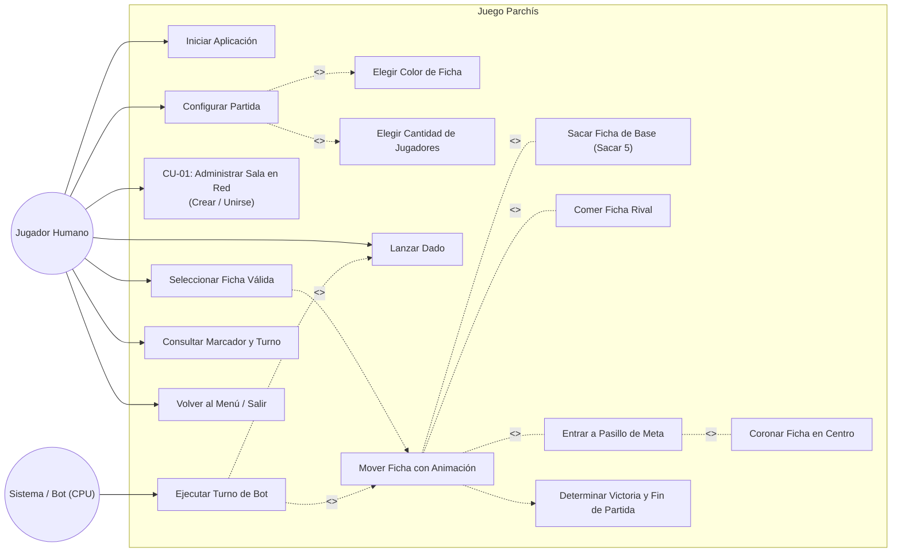

# Parchís - Sistema Distribuido Basado en Eventos

Proyecto académico desarrollado para la materia de **Arquitectura de Software (Unidad II)**. Consiste en la implementación del tradicional juego de mesa **Parchís** en Java, integrando una arquitectura modular por capas, el patrón GoF Fachada/Fábrica, y un **estilo arquitectónico basado en eventos (Event-Driven Architecture - EDA)** que permite partidas tanto en modo **Local (con bots automáticos)** como **En Red** (red de área local Wi-Fi o redes virtuales como Tailscale y ZeroTier).

---

## 📋 Tabla de Contenidos
1. [Visión General del Proyecto](#-visión-general-del-proyecto)
2. [Arquitectura y Estilo del Sistema](#-arquitectura-y-estilo-del-sistema)
3. [Casos de Uso del Sistema](#-casos-de-uso-del-sistema)
   - [Actores del Sistema](#actores-del-sistema)
   - [Diagrama de Casos de Uso](#diagrama-de-casos-de-uso)
   - [Descripción Detallada de los Casos de Uso](#descripción-detallada-de-los-casos-de-uso)
4. [Estructura y Explicación de Clases](#-estructura-y-explicación-de-clases)
   - [Módulo `parchis-interfaces` (Contratos y DTOs)](#1-módulo-parchis-interfaces-contratos-y-dtos)
   - [Módulo `parchis-subsistema-sala` (Lógica de Sala y Fábrica)](#2-módulo-parchis-subsistema-sala-lógica-de-sala-y-fábrica)
   - [Módulo `parchis-eventos` (Infraestructura Distribuida EDA)](#3-módulo-parchis-eventos-infraestructura-distribuida-eda)
   - [Módulo `parchis-presentacion` (GUI Swing y Controladores)](#4-módulo-parchis-presentacion-gui-swing-y-controladores)
5. [Diagramas de Diseño UML](#-diagramas-de-diseño-uml)
6. [Instalación y Ejecución](#-instalación-y-ejecución)
   - [Requisitos](#requisitos)
   - [Compilación con Maven](#compilación-con-maven)
   - [Ejecución en Red (LAN / VPN)](#ejecución-en-red-lan--vpn)

---

## 🎯 Visión General del Proyecto

El sistema ofrece una experiencia completa del juego Parchís para 2, 3 o 4 jugadores (colores: **Rojo**, **Verde**, **Azul** y **Amarillo**):
- **Tablero Gráfico Interactivo:** Renderizado vectorial mediante `Graphics2D` con casillas clásicas (salidas, pasillos de color, casillas de seguro y meta central).
- **Animaciones Suaves Multihilo:** Movimiento de fichas paso a paso interpolado mediante hilos (`Thread`) independientes para no bloquear la interfaz gráfica (EDT de Swing).
- **Inteligencia Artificial (Bots):** Jugadores simulados por computadora que evalúan las reglas del juego y toman decisiones automáticas.
- **Modo en Red Distribuido:** Servidor de eventos centralizado (`EventBroker`) y clientes distribuidos (`EventClient`) comunicados por sockets TCP, capaces de ejecutarse en computadoras distintas sobre redes locales Wi-Fi o VPNs globales (Tailscale / ZeroTier).

---

## 🏛 Arquitectura y Estilo del Sistema

El proyecto sigue una arquitectura desacoplada organizada en módulos Maven y diseñada según dos patrones estructurales clave:

1. **Estilo Arquitectónico Basado en Eventos (EDA - Event-Driven Architecture):**
   - La sincronización entre jugadores distribuidos no depende de llamadas remotas acopladas (RPC/RMI), sino de la emisión y recepción asíncrona de eventos serializables (`EventoDTO`) a través de un canal de eventos central (`EventBroker`).
   - Los clientes implementan el patrón **Publicador/Suscriptor (Pub-Sub)** y **Observer** (`IEventPublisher` e `IEventSubscriber`), manteniendo la consistencia del estado del juego en todas las instancias concurrentes.

2. **Patrón Fachada y Fábrica (Facade & Factory):**
   - El subsistema de administración de salas está desacoplado de la presentación mediante la interfaz `IFachadaSala`.
   - La clase `FabricaSala` suministra la instancia correspondiente (`FachadaSalaMock` para memoria/pruebas o futuras implementaciones persistentes) asegurando que las vistas y controladores jamás dependan de implementaciones concretas ni nombren a los mocks.

```mermaid
flowchart TD
    subgraph Presentacion ["Capa de Presentación (parchis-presentacion)"]
        UI_Menu["ParchisFames (Menú Principal)"]
        UI_Red["DialogoModoRed"]
        UI_Juego["JuegoPanel & TableroPanel"]
        CtrlSala["ControlSala"]
    end

    subgraph Interfaces ["Capa de Interfaces y Contratos (parchis-interfaces)"]
        IFachada["<<interface>> IFachadaSala"]
        ISub["<<interface>> IEventSubscriber"]
        IPub["<<interface>> IEventPublisher"]
        DTOs["DTOs (EventoDTO, SalaDTO, JugadorDTO, MovimientoDTO)"]
    end

    subgraph Sala ["Capa de Negocio (parchis-subsistema-sala)"]
        Fabrica["FabricaSala"]
        MockSala["FachadaSalaMock (Memoria / Pruebas)"]
    end

    subgraph Eventos ["Capa Distribuida Basada en Eventos (parchis-eventos)"]
        Client["EventClient"]
        Broker["EventBroker (Server TCP Sockets)"]
        NetUtil["RedUtil"]
    end

    UI_Menu --> UI_Red
    UI_Menu --> UI_Juego
    UI_Red --> CtrlSala
    CtrlSala --> Fabrica
    Fabrica --> IFachada
    MockSala ..|> IFachada

    UI_Juego --> Client
    Client ..|> IPub
    Client --> Broker
    Broker --> Client
    Client --> ISub
    UI_Juego ..|> ISub
```

---

## 📌 Casos de Uso del Sistema

### Actores del Sistema
- **Jugador Humano:** Usuario interactivo que maneja su turno mediante la GUI Swing.
- **Sistema / Bot (CPU):** Agente computacional que calcula y ejecuta turnos automáticamente para los colores no asignados a humanos en partidas locales.
- **Jugador Remoto:** Usuario conectado en otra computadora que envía y recibe eventos de juego a través del socket de red.

---

### Diagrama de Casos de Uso

A continuación se muestra el diagrama conceptual de los casos de uso implementados en el sistema (disponible en formato PlantUML en `Diagramas/DiagramaCasosDeUso.puml`):



---

### Descripción Detallada de los Casos de Uso

#### CU-01: Administrar Sala en Red (Crear / Unirse a Sala)
- **Propósito:** Permitir a un anfitrión crear una sala multijugador o a un invitado unirse a una existente por red local o VPN.
- **Actores:** Jugador Humano (Host o Cliente).
- **Flujo Básico - Crear Sala:**
  1. El usuario selecciona la pestaña *Crear Sala (Host)* en el diálogo de red.
  2. Ingresa su alias, el puerto de escucha y selecciona su color predilecto.
  3. El sistema activa el `EventBroker` en el puerto especificado e invoca `ControlSala.crearSala(...)`.
  4. La sala queda lista esperando la conexión de los demás clientes.
- **Flujo Básico - Unirse a Sala:**
  1. El usuario selecciona la pestaña *Unirse a Sala (Cliente)*.
  2. Ingresa la dirección IP del anfitrión (obtenida por Wi-Fi o Tailscale/ZeroTier), el puerto, el código de sala, su alias y un color disponible.
  3. El sistema valida los datos e invoca `ControlSala.unirseASala(...)`.
  4. El jugador queda registrado y notifica a los demás integrantes.
- **Flujos Alternos de Negocio:**
  - **Alterno A1 (Sala Llena):** Si la sala ya alcanzó su cupo máximo de 4 jugadores, la fachada arroja `SalaLlenaException` y se muestra un mensaje informativo al usuario.
  - **Alterno A2 (Sala No Encontrada):** Si el código de sala no existe en memoria o la IP/puerto son inalcanzables, se arroja `SalaNoEncontradaException`.
  - **Alterno A3 (Color Ocupado):** Si el color seleccionado ya fue elegido por otro participante de la sala, se arroja `ColorOcupadoException` para que el jugador elija otro color libre.

#### CU-02: Iniciar Aplicación y Navegación Principal
- **Propósito:** Mostrar la pantalla de bienvenida con opciones para iniciar partida local, partida en red o cerrar el juego.
- **Actores:** Jugador Humano.
- **Flujo:** La ventana `ParchisFames` presenta los accesos a `SeleccionPanel` (modo local), `DialogoModoRed` (modo red) y el botón de salida.

#### CU-03: Configurar Partida Local
- **Propósito:** Configurar los parámetros de una partida en una sola máquina contra la computadora.
- **Actores:** Jugador Humano.
- **Flujo:** Mediante `SeleccionPanel`, el usuario escoge la cantidad de competidores (2, 3 o 4) y el color de sus fichas (Rojo, Verde, Azul o Amarillo). Al aceptar, se instancia `JuegoPanel` y se configuran los bots para los colores restantes.

#### CU-04: Lanzar Dado
- **Propósito:** Obtener el valor de avance del turno actual.
- **Actores:** Jugador Humano o Bot (CPU).
- **Flujo:**
  1. Al presionar el botón *Lanzar Dado*, se ejecuta una animación gráfica de giro (`Girando_Dado.png`) durante 500 ms.
  2. Se calcula un valor aleatorio entre 1 y 6.
  3. Se muestra la cara correspondiente del dado (`Dado_X.png`).
  4. En partidas en red, el evento `TipoEvento.DADO_LANZADO` es propagado a todos los participantes.

#### CU-05: Seleccionar Ficha Válida
- **Propósito:** Permitir al jugador elegir qué ficha mover de acuerdo a las reglas oficiales del Parchís.
- **Actores:** Jugador Humano o Bot (CPU).
- **Flujo:**
  1. El sistema evalúa todas las fichas del jugador activo:
     - Si está en la base (nido), únicamente puede seleccionarse si el dado arrojó un **5**.
     - Si está en la pista, debe poder avanzar la cantidad del dado sin exceder la casilla 68 del recorrido total (meta).
  2. Las fichas válidas inician una animación de **pulso visual dorado** (`pulseTimer`) sobre el tablero para orientar al jugador humano.
  3. El usuario hace clic sobre la ficha elegida.

#### CU-06: Mover Ficha con Animación
- **Propósito:** Animar el desplazamiento paso a paso de la ficha y aplicar las consecuencias en el tablero.
- **Actores:** Sistema (`TableroPanel` / Hilo de movimiento).
- **Flujo:**
  1. Se genera un `Thread` que interpola las coordenadas visuales de la ficha entre casilla y casilla a una velocidad constante (20 ms por paso).
  2. Al culminar el desplazamiento se evalúan las condiciones de juego:
     - **Sacar de Base (<<extend>>):** La ficha pasa de su nido a la casilla de salida de su color (Rojo=39, Verde=56, Azul=22, Amarillo=5).
     - **Comer Ficha Rival (<<extend>>):** Si la casilla final está ocupada por una ficha adversaria y **no es una casilla de seguro**, la ficha contraria es capturada, devuelta a su base, y se notifica el evento `FICHA_COMIDA`.
     - **Entrar a Pasillo de Meta (<<extend>>):** Al superar la casilla de entrada correspondiente, la ficha ingresa al carril exclusivo de 8 casillas de su color.
     - **Coronar en Centro (<<extend>>):** Al alcanzar el paso 68, la ficha se declara coronada y queda asegurada en el centro.

#### CU-07: Ejecutar Turno de Bot Automático
- **Propósito:** Automatizar las decisiones de los oponentes controlados por la computadora.
- **Actores:** Sistema / Bot (CPU).
- **Flujo:**
  1. Se inicia un hilo con un retraso deliberado para dar realismo a la partida.
  2. El bot lanza el dado virtualmente y consulta las fichas movibles.
  3. Si no hay movimientos posibles, pasa el turno automáticamente.
  4. Si hay opciones, aplica una heurística que prioriza **sacar fichas de la base** y, en su defecto, avanzar la ficha que se encuentre más adelantada hacia la meta.

#### CU-08: Sincronizar Eventos en Red
- **Propósito:** Replicar en tiempo real todas las acciones de juego entre las computadoras conectadas.
- **Actores:** `EventBroker`, `EventClient`.
- **Flujo:** Cada vez que un jugador lanza el dado, mueve una ficha o captura un rival, se serializa un `EventoDTO` con el tipo correspondiente (`DADO_LANZADO`, `FICHA_MOVIDA`, `FICHA_COMIDA`, `PARTIDA_FINALIZADA`) y el broker lo retransmite a todas las ventanas suscritas para replicar la animación idénticamente.

#### CU-09: Determinar Victoria y Finalizar Partida
- **Propósito:** Detectar el ganador del juego y pausar la partida de manera ordenada.
- **Actores:** Sistema.
- **Flujo:**
  1. Cuando un jugador acumula sus **4 fichas coronadas**, se dispara el método `manejarFinDePartida`.
  2. Se deshabilitan los controles de inmediato y se suspenden los hilos de los bots para evitar turnos residuales.
  3. Se despliega un diálogo modal de felicitación que permite reiniciar la partida o volver al menú principal.

---

## 💻 Estructura y Explicación de Clases

El código fuente está dividido en cuatro módulos principales según su responsabilidad técnica:

```
Parchis/
├── parchis-interfaces/          # Contratos públicos, interfaces y DTOs
├── parchis-subsistema-sala/     # Lógica de creación de salas y fábrica desacoplada
├── parchis-eventos/             # Servidor Broker, Clientes Sockets y utilidades de red
└── parchis-presentacion/        # Interfaz de usuario Swing, Tablero 2D y animaciones
```

---

### 1. Módulo `parchis-interfaces` (Contratos y DTOs)

Define los modelos de transferencia de datos y contratos entre subsistemas, garantizando bajo acoplamiento:

| Clase / Interfaz | Tipo | Responsabilidad y Métodos Principales |
| :--- | :--- | :--- |
| **`IFachadaSala`** | Interfaz | Contrato del subsistema de salas (CU-01). Métodos: `crearSala(...)`, `unirseASala(...)`, `consultarSala(...)`, `iniciarPartida(...)`, `registrarListener(...)`. |
| **`ISalaListener`** | Interfaz | Listener del patrón Observer para salas. Callbacks: `onJugadorUnido(...)`, `onPartidaIniciada(...)`, `onError(...)`. |
| **`IEventPublisher`** | Interfaz | Contrato del estilo basado en eventos para publicar mensajes. Método: `publicarEvento(EventoDTO evento)`. |
| **`IEventSubscriber`** | Interfaz | Contrato para componentes que desean consumir eventos. Método: `onEventoRecibido(EventoDTO evento)`. |
| **`EventoDTO`** | DTO (Serializable) | Mensaje universal distribuido. Contiene: `tipo` (`TipoEvento`), `emisor` (String), `codigoSala` (String), `payload` (Object) y `timestamp` (long). |
| **`TipoEvento`** | Enum | Tipos de eventos del broker: `MENSAJE_CHAT`, `SALA_CREADA`, `JUGADOR_UNIDO`, `PARTIDA_INICIADA`, `DADO_LANZADO`, `FICHA_MOVIDA`, `FICHA_COMIDA`, `TURNO_CAMBIADO`, `PARTIDA_FINALIZADA`, `ERROR`. |
| **`JugadorDTO`** | DTO (Serializable) | Representa a un jugador: `id`, `nombre`, `color`, estado `anfitrion` y estado `listo`. |
| **`SalaDTO`** | DTO (Serializable) | Representa el estado de una sala: `codigo`, `capacidadMaxima`, lista de `JugadorDTO`, `enPartida`, métodos auxiliares `estaLlena()` y `tieneColorOcupado(color)`. |
| **`MovimientoDTO`** | DTO (Serializable) | Datos específicos de un movimiento: `jugador` (int), `idFicha` (int) y `pasos` (int). |
| **`PartidaDTO`** | DTO (Serializable) | Información general de una partida en curso (código, jugadores, turno actual, estado). |
| **Excepciones de Negocio** | Excepciones | `ParchisException` (base), `SalaLlenaException` (Alterno A1), `SalaNoEncontradaException` (Alterno A2) y `ColorOcupadoException` (Alterno A3). |

---

### 2. Módulo `parchis-subsistema-sala` (Lógica de Sala y Fábrica)

Encapsula la administración de salas y las reglas de negocio de unión e inicio de juego:

| Clase | Responsabilidad y Detalles Técnicos |
| :--- | :--- |
| **`FabricaSala`** | Factoría estática (`getFachada()`, `setFachada(...)`). Desacopla por completo la capa de presentación de la implementación de la fachada, permitiendo alternar entre `FachadaSalaMock` e implementaciones de base de datos sin modificar las vistas. |
| **`FachadaSalaMock`** | Implementación en memoria de `IFachadaSala` para pruebas y prototipado rápido. Utiliza `ConcurrentHashMap<String, SalaDTO>` para garantizar concurrencia en la manipulación de salas y simula los flujos alternos A1, A2 y A3. |

---

### 3. Módulo `parchis-eventos` (Infraestructura Distribuida EDA)

Implementa la arquitectura basada en eventos mediante sockets TCP concurrentes:

| Clase | Responsabilidad y Detalles Técnicos |
| :--- | :--- |
| **`EventBroker`** | Servidor central de eventos multihilo. Escucha en un puerto TCP (por defecto 9999) mediante `ServerSocket`. Por cada cliente conectado genera un hilo interno `ClienteHandler`. Cuando un cliente publica un `EventoDTO`, el broker realiza un **broadcast** retransmitiéndolo inmediatamente a todos los demás clientes conectados a la partida. |
| **`EventClient`** | Cliente de eventos que implementa `IEventPublisher`. Se conecta al broker a través de un `Socket`. Inicia un hilo demonio receptor (`Hilo-ReceptorEventos`) que escucha eventos entrantes de la red en segundo plano y los despacha a la lista local de suscriptores (`IEventSubscriber`). |
| **`RedUtil`** | Clase utilitaria para inspeccionar las interfaces de red del sistema operativo (`NetworkInterface`). Detecta y clasifica automáticamente las direcciones IPv4 de adaptadores **Wi-Fi**, **Ethernet**, y redes privadas virtuales como **Tailscale** (rango `100.x.x.x`) y **ZeroTier**. |
| **`PrototipoEstiloMain`** | Clase ejecutable de prueba que demuestra el funcionamiento del broker y clientes simulados en consola. |

---

### 4. Módulo `parchis-presentacion` (GUI Swing y Controladores)

Implementa la interfaz gráfica, la interacción del usuario y el motor visual del juego:

| Clase | Responsabilidad y Detalles Técnicos |
| :--- | :--- |
| **`ParchisMain` / `Parchis`** | Punto de entrada principal (`main`). Establece el Look & Feel de Java Swing (Nimbus) e inicializa la ventana del menú principal (`ParchisFames`). |
| **`ParchisFames`** | Ventana principal (`JFrame`) con diseño gráfico de presentación. Contiene los botones de acceso rápido: *Partida Local (Bots)*, *Partida en Red (Wi-Fi / VPN)* y *Salir*. |
| **`SeleccionPanel`** | Panel modal de configuración para partidas locales. Permite seleccionar el número de rivales (2, 3 o 4) y el color de fichas del jugador humano mediante `JRadioButton` agrupados. Notifica su resultado a través de la interfaz callback `NavegacionListener`. |
| **`DialogoModoRed`** | Diálogo modal avanzado para partidas en red. Cuenta con pestañas independientes para **Host** (crear sala) y **Cliente** (unirse a sala), autocompletado de IP local mediante `RedUtil`, selección de colores disponibles y enlace directo con `ControlSala`. |
| **`ControlSala`** | Controlador de presentación para el CU-01. Interactúa exclusivamente con `IFachadaSala` obtenida mediante `FabricaSala.getFachada()`. Captura excepciones de negocio (`ColorOcupadoException`, `SalaNoEncontradaException`, etc.) y las traduce en respuestas visuales mediante `VistaSalaCallback`. |
| **`JuegoPanel`** | Controlador orquestador del juego (`JPanel`). Maneja la lógica de turnos, el lanzamiento de dados con temporizadores Swing, la ejecución de turnos de IA en hilos paralelos (`ejecutarTurnoBot`), la suscripción a eventos de red con `EventClient` y la gestión del fin de partida (`manejarFinDePartida`). |
| **`TableroPanel`** | Componente gráfico personalizado (`JPanel`). Sobrescribe `paintComponent(Graphics g)` para dibujar con `Graphics2D` el tablero oficial de Parchís (bases en esquinas, 68 casillas exteriores, 12 seguros, 4 pasillos de meta y el centro). Controla el pulso visual dorado (`pulseTimer`) en fichas movibles, la detección de eventos de ratón (`hover` y `click`) y la animación fluida paso a paso. |
| **`TableroPanel.Ficha`** | Clase interna que modela las 16 fichas del juego (4 fichas por color). Atributos: `jugador`, `id`, `enBase`, `pasosRecorridos`, `coronada`, `animX`, `animY` y estado de animación. |
| **`TableroPanel.TableroListener`**| Interfaz callback para comunicar el motor gráfico del tablero con el controlador `JuegoPanel`. Métodos: `onMovimientoFinalizado()`, `onFichaMovidaLocal(...)`, `onMensaje(...)`, `onFichaComida(...)` y `onVictoria(...)`. |

---

## 📊 Diagramas de Diseño UML

El proyecto incluye diagramas UML completos en la carpeta [`Diagramas/`](file:///c:/ArquitecturaParchis/Clon%20Red/Parchis/Diagramas):

1. **Diagrama de Casos de Uso (`DiagramaCasosDeUso.puml` / `.png`):** Modela a los actores (Humano, Bot), los casos de uso principales y sus relaciones `<<include>>` y `<<extend>>`.
2. **Diagrama de Clases (`DiagramaClases.puml` / `.png`):** Detalla las clases del subsistema de presentación, sus relaciones de herencia, composición y callbacks.
3. **Diagrama de Componentes (`DiagramaComponentes.puml` / `.png`):** Ilustra las 4 capas del sistema (`parchis-presentacion`, `parchis-subsistema-sala`, `parchis-interfaces`, `parchis-eventos`) y sus dependencias mediadas por interfaces.
4. **Diagrama de Secuencia (`DiagramaSecuencia.puml` / `.png`):** Modela el ciclo de vida de un turno, desde el clic en lanzar dado, el cálculo de fichas válidas, la animación interpolada en hilo secundario, la verificación de capturas y el pase de turno al bot.

---

## 🚀 Instalación y Ejecución

### Requisitos
- **Java Development Kit (JDK):** Versión 21 o superior.
- **Apache Maven:** Versión 3.8+ (o un IDE con soporte integrado como Apache NetBeans, IntelliJ IDEA o Eclipse).

### Compilación con Maven

Para compilar y empaquetar todos los módulos del proyecto, ejecute en la raíz:

```bash
mvn clean install
```

Para ejecutar las pruebas unitarias automatizadas de la fachada y eventos:

```bash
mvn test
```

### Ejecución de la Aplicación

Para iniciar el juego mediante Maven:

```bash
mvn --projects parchis-presentacion exec:java -Dexec.mainClass="parchis.presentacion.ParchisMain"
```

O ejecutando directamente el archivo principal desde su IDE:
`parchis.presentacion.ParchisMain` o `parchis.Parchis`.

---

### Ejecución en Red (LAN / VPN)

1. **Partida en Red Local (Misma red Wi-Fi o Ethernet):**
   - **Jugador 1 (Anfitrión):** Inicia la app, hace clic en *Partida en Red*, entra a la pestaña *Crear Sala (Host)*, copia la IP mostrada (ej. `192.168.1.X`) y presiona *Crear Sala*.
   - **Jugadores 2, 3 y 4 (Clientes):** Inician la app, seleccionan *Partida en Red*, entran a *Unirse a Sala (Cliente)*, ingresan la IP del anfitrión y seleccionan un color distinto.

2. **Partida a Distancia con VPN Virtual (Tailscale / ZeroTier):**
   - Ambos equipos deben tener instalado y activo **Tailscale** o **ZeroTier** en la misma red privada.
   - El anfitrión selecciona en el diálogo su IP virtual de Tailscale (ej. `100.x.y.z`) y los clientes introducen dicha dirección.
